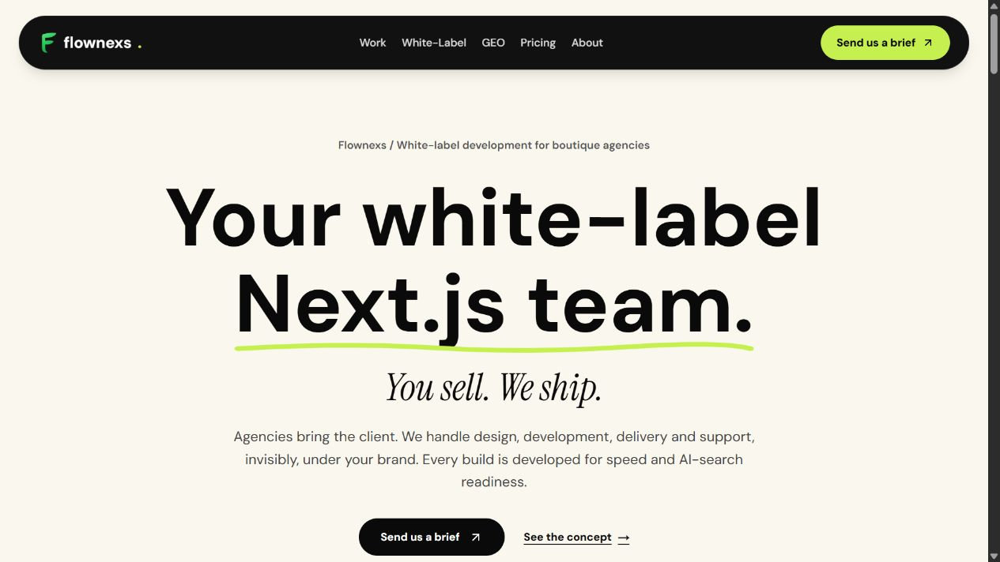

# Flownexs — Agency Homepage

An agency-focused website presenting white-label web development services through a bold, focused interface.

**[Visit the live website](https://flownexs.com)** · [Contact Ammanuel](mailto:ammanuelgirma015@gmail.com)

## My contribution

I built the homepage, translating the agency's services into a responsive web experience with strong typography, clear content hierarchy and enquiry routes.

## Interface highlights

- Cream, black and lime visual treatment.
- Responsive page layout and prominent calls to action.
- Clear presentation of services and the agency delivery model.

## Technology

Next.js, React and TypeScript.

## About this showcase

This repository contains a project description and a screenshot of the public website. Commercial source code remains private. The screenshot represents the site at the time of capture; the live website may evolve.

**Ammanuel Girma** · Full-stack developer · Addis Ababa, Ethiopia

[LinkedIn](https://www.linkedin.com/in/ammanuel-girma/) · [Email](mailto:ammanuelgirma015@gmail.com)
